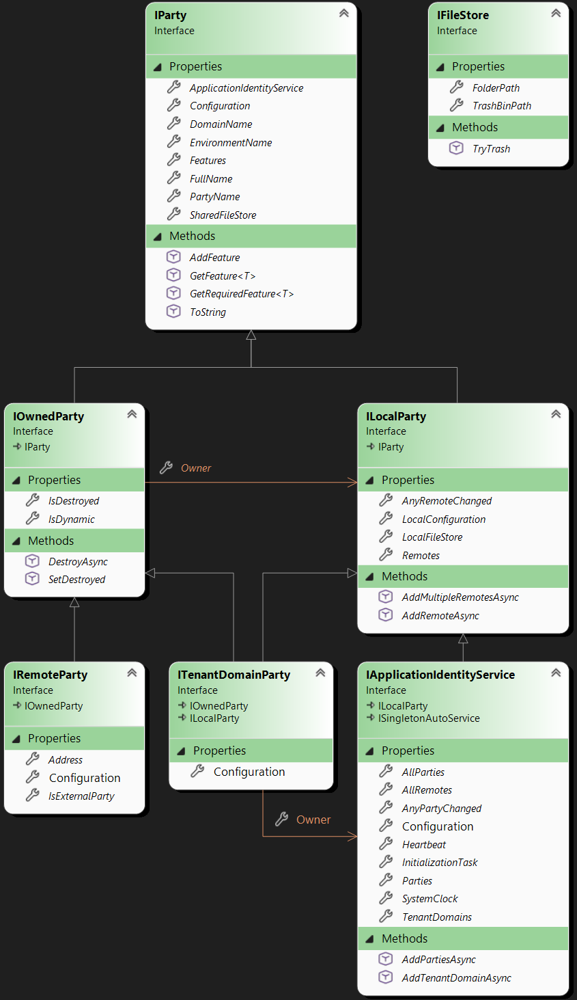

# Application identity model

This "running" model is built from the immutable `ApplicationIdentityServiceConfiguration` 
(you should first read the [Application identity model configuration](../CK.AppIdentity.Configuration/README.md)
documentation before this one). This is why this package references `CK.AppIdentity.Configuration`, and not
the reverse: the model is built from the configuration and nothing else - an identity object exists because a
configuration section described it, or because it was added dynamically at runtime through the same configuration shape.

The resulting `IApplicationIdentityService` obtained is a "nearly" immutable object: configured Parties
are immutable but this can be extended by "dynamic parties". These dynamic parties are then also
immutable and, in the case of a `ITenantDomainParty` can also be extended by dynamic `IRemoteParty`. 

## The model



`ITenantDomainParty` is the only type that is both owned and local: it belongs to the service **and**
holds remotes of its own. `IApplicationIdentityService` is local but owned by nobody, and it is an
`ISingletonAutoService`, so it is resolved rather than constructed.

This model is "totally typed", there is no need for any property to be cast into a more precise
type (this is why the 3 fundamental objects that are `IRemoteParty`, `ITenantDomainParty`
and `IApplicationIdentityService` all expose their respective `RemotePartyConfiguration`,
`TenantDomainPartyConfiguration` and `ApplicationIdentityServiceConfiguration` Configuration property.

Every party also has a `PartyActorId`: its identifier in the actors model (its PartyActor), 0 until it is resolved.
It is the identity of the party when it calls another one, or when it receives a command directly (the caller party of
the authentication information). This package holds only the value, with no authentication logic: an initialization
step (the PartyActor registrar of the authentication center packages) sets it once with `TrySetPartyActorId`. It can
only go from 0 to an identifier, never change afterwards, and the change is logged.

## The FileStore

An [`IFileStore`](IFileStore.cs) is simply a local directory in the file system. The file's physical path
is exposed (it's simple and transparent): Features can use basic file and directory management APIs to
exploit them.

These directories are automatically created and made available and are machine-dependent: by default, they are in the
[Environment.SpecialFolder.LocalApplicationData](https://stackoverflow.com/a/9709394/190380)/CK-AppIdentity folder:
-	On Windows : C:\Users\username\AppData\Local\CK-AppIdentity
-	On Linux: /home/username/.local/share/CK-AppIdentity
 
This means that these directories are, in effect, shared by different applications using CK-AppIdentity on the same machine...
And this is perfectly deliberate! It may seem surprising, but this choice allows :

- Unify (at last!) application working directories. Whether it's a Web application, a console or something else,
  the "ACMELogistics/EN/$Portal" Party is necessarily unique (in the logical sense, not necessarily at all times, given
  application recycling and other artifacts). It doesn't matter how it's positioned on the file system: host (exe) applications
  can be moved freely.
- The ability to move Tenants between different hosts, whether they're on the same machine or transferred to another host: all
  application data for a local Tenant must be stored in its LocalFileStore.

This requires applications using CK-AppIdentity to use this directory as the root of all their "application data".

Each Party has a **SharedFileStore** which is accessible to all Parties running on the same machine. RemoteParty are Parties:
their SharedFileStore is a cache that is used to manage information related to that Remote (independently of any local Party).
Typically, this is where you'll find a Remote's public keys.

If different local applications (different processes) interact with the same remote, then the work of obtaining public keys
will be "mutualized": this directory is a cache that **can be updated by any of the local applications** as they interact with it.

Each LocalParty exposes a **LocalFileStore**: this space is dedicated to information that is (and should be) of interest only to
the local Party. 

In theory, it doesn't matter how these directories are structured on the file system (hash codes could be used, for example).
However, we believe that these stores should be easy to understand. In practice, we have decided that the environment ("#Dev",
"#Prod", etc.) should form the first level. Then, naturally, we exploit the Domain and its potentially hierarchical path, followed
by the $PartyName: this directory is the **SharedFileStore**.

Because the SharedFileStore path is derived from the Party's FullName, FullNames are unique regardless of the case:
two Parties whose names differ only by case cannot coexist, so they can never share the same directory on a case
insensitive file system (typically Windows). Once this is guaranteed, the `IParty.FullName` (a `NormalizedPath`) can
safely be compared with its ordinal (case sensitive) equality.

The **LocalFileStore** is inside the **SharedFileStore** of the Party: it is the "*-Local*" folder. This results in a rather readable structure.
Here's a very simple example (with a test store root, which explains why we're not in %LOCALAPPDATA%) with two Parties in the same "Test" domain.

```
TestStore/
└── #Dev/                                                 <- the environment is the first level
    └── Test/                                             <- then the Domain and its path
        ├── $Listener/                                    <- SharedFileStore of Test/$Listener
        │   ├── -Local/                                   <- its LocalFileStore
        │   │   └── Keys/
        │   └── Identity.<seq>.trust                      <- a file written by a feature
        └── $Sender/                                      <- SharedFileStore of Test/$Sender
            └── -Local/
```

The presence of "-Local" in the 2 Party directories indicates that they both run on the same machine. The ".trust" file is
what a key management feature stores in the SharedFileStore of the remote "$Listener": the pinned identity of that remote.
For an example of such a feature, see
[CK.AppIdentity.KeyManagement](https://github.com/signature-opensource/CK-AppIdentity-Transport/tree/stable/CK.AppIdentity.KeyManagement)
in the CK-AppIdentity-Transport repository, which is built on this package.

## And here come the Features...

These objects don't do more by themselves than being what they are. This can be seen as a "configurable
structure" on which the "Features" come into play. Features can decorate any of these objects and carry
the actual functionalities like managing the Key store of a Remote party, exposing the Google API of
a Google external Remote, etc.

This package only exposes how a party carries them (`IParty.AddFeature`, `GetFeature<T>` and
`GetRequiredFeature<T>`). The feature drivers that create and configure them are implemented by `CK.AppIdentity`,
which depends on this package: see its [Features](../CK.AppIdentity/Features/README.md) documentation.

