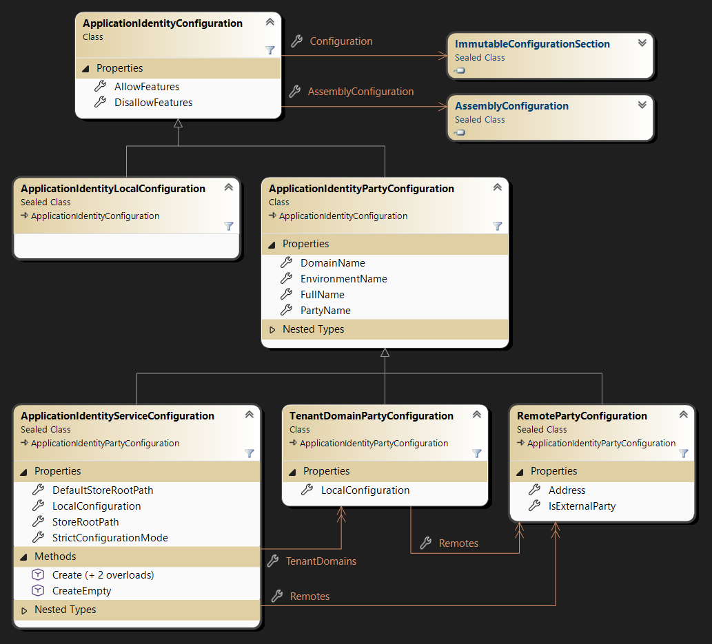

# Application identity model configuration

The goal of this configuration is to be the single central point of configuration for an application (called a Party)
and its peers (its Parties) and to "carry" all the communication and interaction services with its parties:
- It is as simple as possible to configure.
- Once initially configured, no configuration change is possible during the execution **for what has been configured**.
- Dynamic parties are supported (these are the non initially configured beasts).

Application identity may be the only aspect that requires an explicit configuration. Any other aspect
can have a default behavior, but the remote parties an application interacts with, and how it interacts
with them, can hardly exist without configuration.

> One should be able to understand the role of an application and its interactions with the external world
by looking at its configuration.

The [configuration samples](docs/Samples.md) introduce the basic concepts of CK.AppIdentity step by step: remote
parties, which side is the client and which is the server, tenant domains, the "Local" sections and the "Defaults"
sections.

## Configuration keys

| Key | Where | Description |
|-----|-------|-------------|
| `FullName` | root, parties | `"Domain/$Party/#Environment"`. The party and the environment can be omitted. |
| `DomainName`, `PartyName`, `EnvironmentName` | root, parties | The 3 parts of the full name, when `FullName` doesn't define them (`DomainName` cannot be used with `FullName`). A party inherits the domain and environment names of its parent. |
| `Parties` | root, tenant domains, groups | The parties. An item with no `PartyName` (nor `FullName`) is a group: its `Parties` are flattened into the enclosing list. An item with no `Address` whose `PartyName` is the last segment of its domain (`"AcmeCorp/$AcmeCorp"`) is a tenant domain; any other item is a remote party. |
| `Address` | remote parties | Where the remote can be reached. The party that declares the address initiates the communication (the client); the other side listens (the server). |
| `Local` | root, tenant domains | The configuration of the local party: the application (or the tenant), see the [samples](docs/Samples.md#the-local-and-the-defaults-configurations). |
| `Defaults` | root, tenant domains, groups | The default values of the parties below this level (its `Local` included): see [the levels and the defaults](#the-structural-levels-and-the-defaults). |
| `AllowFeatures`, `DisallowFeatures` | parties (`Local`, remotes), `Defaults` | Feature names: a string, a comma-separated string or an array of strings. Combined along the `Defaults` above the party (the nearest level wins). |
| `DefaultAssembly`, `Assemblies` | parties (`Local`, remotes), `Defaults` | The [`AssemblyConfiguration`](https://github.com/signature-opensource/CK-Configuration/blob/stable/CK.Configuration/README.md#assemblyconfiguration) of CK.Configuration: the "plugins/dynamic extension" assemblies. Combined along the `Defaults` above the party. |
| `StrictConfigurationMode` | root | Whether warnings are errors (see [below](#strictly-checking-the-configuration-or-not)). |
| `StoreRootPath` | root | A fully qualified path. When not configured, the store is private and defaults to `ApplicationIdentityServiceConfiguration.DefaultStoreRootPath` (the `CK-AppIdentity` folder in `Environment.SpecialFolder.LocalApplicationData`). |
| `TrashBinRetention` | root | How long trashed files are kept: a `TimeSpan` like `"7.00:00:00"` (the default, 7 days). |

The DomainName, PartyName and EnvironmentName are strictly defined
(see [CK.Core.CoreApplicationIdentity](https://github.com/signature-opensource/CK-Core/tree/stable/CK.Core/CoreApplicationIdentity)).

The FullName identifies a Party: it must be unique **regardless of the case**. "AcmeCorp/$Trolley1/#Production" and
"acmecorp/$trolley1/#production" denote the same Party, so a configuration that defines both is invalid, and a dynamic
party whose name differs only by case from an existing one is rejected. This is stricter than CoreApplicationIdentity
(which only states that the DomainName is case sensitive) and avoids clashes between the Parties' file stores on
case insensitive file systems. The file stores belong to the running model, which is built on this package: for their
layout, see [The FileStore](../CK.AppIdentity.Abstractions/README.md#the-filestore) in CK.AppIdentity.Abstractions.

## The structural levels and the defaults

The root, a tenant domain and a group of parties are **structural levels**: their own keys are only their identity and
their structure (the names, `Parties`, `Local`, `Defaults`, and at the root `StoreRootPath`, `TrashBinRetention` and
`StrictConfigurationMode`). Any other key on a level is an error: nothing is implicitly inherited from a level.

- The configuration of a **local party** (the application, or a tenant) is its `"Local"` section.
- The configuration of a **remote party** is its own entry (a remote has no `"Local"` and no `"Defaults"`).
- A level's **`"Defaults"`** section holds the default values of all the parties below it, its `"Local"` included. A
  value is the party's own key, otherwise the one of the nearest `"Defaults"` above it. `"Defaults"` cannot hold an
  identity or a structure (names, `Parties`, `Local`, `Defaults`, `Address`...).

```jsonc
{
  "FullName": "Acme/$App",
  "Defaults": { "AllowFeatures": "KeyManagement" },     // For all the parties below, the root's "Local" included.
  "Local": { "AllowFeatures": "AuthCenter" },            // The application: KeyManagement and AuthCenter.
  "Parties": [
    { "PartyName": "Front" },                            // KeyManagement.
    { "PartyName": "Box", "DisallowFeatures": "KeyManagement" }
  ]
}
```

The `AllowFeatures` and `DisallowFeatures` combine: the ones of the farthest `"Defaults"` first, then the nearer ones,
and finally the party's own keys (a feature allowed below is removed from the disallowed ones, and conversely). The
assemblies combine the same way (`AssemblyConfiguration.Resolve` of CK.Configuration, with its locking). The feature
drivers read a local party in its `LocalConfiguration` and a remote in its configuration. Any other setting of a party
is resolved with the `TryResolveValue` / `TryResolveSection` extension methods of CK.Configuration (the party's own key,
then the `"Defaults"` above).

The configuration is provided by the .NET abstraction
[IConfigurationSection](https://learn.microsoft.com/fr-fr/dotnet/api/microsoft.extensions.configuration.iconfigurationsection)
that can originate from multiple configuration providers (the samples are in JSON).

## Mutable and immutable IConfigurationSection helpers (from CK.Configuration).

To manage this lower level of configuration (and guaranty its immutability), we use [CK.Configuration](https://github.com/signature-opensource/CK-Configuration/blob/stable/CK.Configuration/README.md).

A `ImmutableConfigurationSection` is a `IConfigurationSection` that captures once for all the content and path of any other `IConfigurationSection`.

Each application identity objects is bound and exposes its immutable configuration section.

The `MutableConfigurationSection` acts as a builder for immutable configuration and hence is used to
initialize dynamic parties.


### Strictly checking the configuration (or not)

A `StrictConfigurationMode` boolean property drives whether warnings must be considered as errors.
This defaults to false only when environment name is "#Dev" (the default, non configured environment
name) but can always be explicitly configured at the root configuration level.

The goal is to be strict but some configuration may emit annoying warnings. When this happens,
the global approach is to temporarily set the `StrictConfigurationMode` to false and to consider
those annoying warning as "bugs" that must be fixed by emitting an Info instead of a Warn. Once done,
strict mode can be set back to true.


### The Configuration model
A `ImmutableConfigurationSection` successfully analyzed results in multiple objects described below:



Two things the diagram makes plain. `ApplicationIdentityLocalConfiguration` is **not** a party
configuration - it derives straight from the base, which is why a `"Local"` section carries settings
and not an identity. And `AllowFeatures` / `DisallowFeatures` / `AssemblyConfiguration` sit on the base
class: they are resolved for the parties (a `"Local"`, a remote) and empty for the structural levels (the root and the
tenant domains, whose local party is their `LocalConfiguration`).

This model shows the 3 main types of identity objects:
- **ApplicationIdentity** is the root object.
- It holds a collection of **TenantDomains** and a collection of **Remotes**.
- A **TenantDomain** also holds a collection of **Remotes**.
- All configurations are issued and expose their `ImmutableConfigurationSection` configuration and
  a `AssemblyConfiguration` that captures possible "plugins/dynamic extension" assemblies.

The "runtime" model is initialized from these configuration objects. It is described by
[CK.AppIdentity.Abstractions](../CK.AppIdentity.Abstractions/README.md), which depends on this package.
