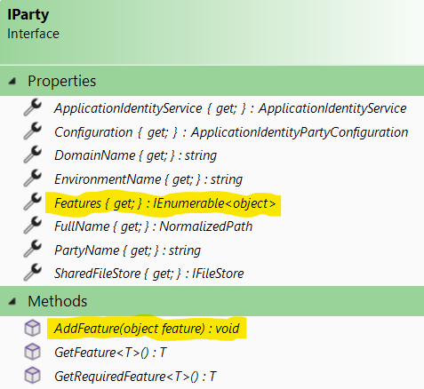
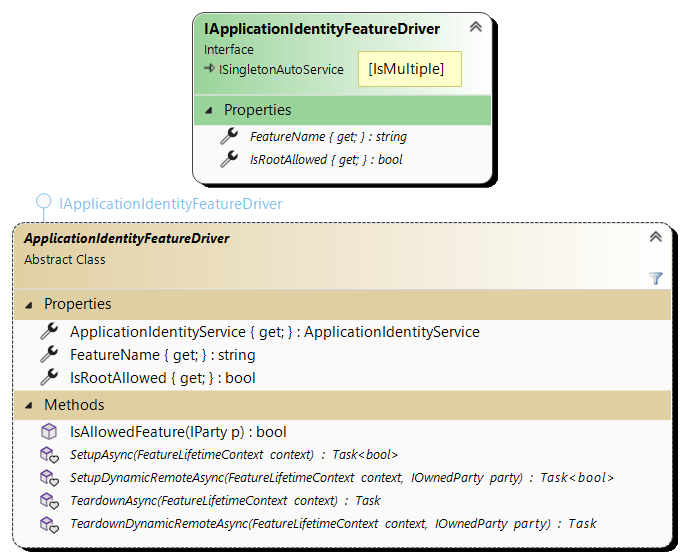

# The Features

If the ["run time" model](../../CK.AppIdentity.Abstractions/README.md) is a skeleton, the Features are the muscles.

Features are not typed: they are objects that can be very simple or very complex, and which decorate
each Party. From the outside, the API is trivial:



Features can only be added, not removed. 

## The Package First approach

In practice, we don't use this `AddFeature` method directly, as the addition and initialization of the Features that decorate each Party is
carried out automatically by the Feature drivers, which are automatic singleton services: simply installing the Feature's NuGet package
makes it operational (this is the "Package First" approach). To facilitate development, a Template Method is available, which you simply
need to specialize.

A driver is responsible for:
- Creating, initializing and adding any Features it wishes to the system's initial Parties (by implementing the `SetupAsync` method);
- Doing the same for any dynamic Parties that appear (by implementing the `SetupDynamicRemoteAsync` method);
- doing whatever is necessary when a dynamic Party is deleted (by implementing the `TeardownDynamicRemoteAsync` method);
- and finally, doing whatever is necessary when the entire Service is deleted, which in practice corresponds to a host application
  shutdown (by implementing the `TeardownAsync` method).

These functions are called by the micro agent ([AppIdentityAgent](../AppIdentityAgent.cs)) which manages the lifecycle of Parties and
Features.



A Feature can be opt-in or opt-out. The implementation expresses this via the constructor of the abstract class:
```csharp
protected ApplicationIdentityFeatureDriver( ApplicationIdentityService s, bool isAllowedByDefault )
```

Configuration then takes over via "Allow/DisallowFeatures", which control the final list of associated features for each Party:

- The feature name is deduced from the driver type: a `XXXFeatureDriver` manages the "*XXX*" feature. It is this name that is
  used in the configuration.
- The driver implementation can then use the `bool IsAllowedFeature( IParty p )` helper method, which will give it the final result of the
  Allow/Disallow configurations for the given Party according to the configuration sections (up to the configuration root).
- Setup methods can fail. Rather than throwing an exception, they are prompted to issue error logs and simply return false (but if they
  throw, this is of course handled).
- Teardown methods are not expected to fail.

The order in which driver methods are called respects the dependencies between drivers: if the driver in Feature "A" depends on
Feature "B", then :

- `SetupAsync` and `SetupDynamicRemoteAsync` of "A" will be called after the setup methods of "B" have been called.
- The Teardowns are reversed: "B" will only be called upon after "A" has done its cleaning job.

## Asymmetric features

An **asymmetric feature** is implemented by one party and used by others, which relay it to that party: an
Authentication Center, or a mail sender that holds the mail server's configuration and its secrets for the parties
that send mails through it.

### The packages

For the asymmetric feature "*XXX*":

| Package | Content |
|---|---|
| CK.AppIdentity.XXX.Local | The core code: the `LocalXXXFeatureDriver`, the implementation of the feature. |
| CK.IO.XXX | The Cris commands (public or internal) that the remotes send to the local party that is the feature. |
| CK.AppIdentity.XXX.Remote | The `RemoteXXXFeatureDriver` and the code that relays the feature to the remote that is the feature. |
| CK.AppIdentity.XXX | Optional: the common implementation. |

The two drivers give the feature name explicitly to the base constructor `ApplicationIdentityFeatureDriver( s, "XXX" )`
(the prefix is never removed implicitly: a `LocalStorageFeatureDriver` manages "*LocalStorage*"). A common
`XXXFeatureDriver` is possible but optional: it is only useful when consumers that ignore the side need one driver to
depend on (the AuthCenter and the MailSender have none). The drivers of a feature agree on `isAllowedByDefault`: it
defaults to false, and true makes little sense (every local party would be the feature and every remote one of its
callers): it must be exceptional. Two drivers can never manage the same feature otherwise.

### The configuration

The name is "*XXX*" in the `Local` of a local party (the root or a tenant domain) and "*XXXRemote*" on a remote
(`GetFeatureName( IParty p )` gives the name of a party). The "*XXX*" of the `Local` gives the role of the local party:

| | The local party allows "*XXX*": it **is** the feature | The local party doesn't allow "*XXX*" |
|---|---|---|
| The Local side (`LocalXXXFeatureDriver`) | implements the feature. The remotes that allow "*XXXRemote*" are the ones that can call it (a "Defaults" that allows "*XXXRemote*" lets all of them call it): the calls of a remote that doesn't allow it are refused. | does nothing (as if it was not there). |
| The Remote side (`RemoteXXXFeatureDriver`) | does nothing (as if it was not there). | relays the feature to **the** remote that allows "*XXXRemote*", if any: this remote is the feature. |

- **The feature can be configured on both sides of the relationship:** the `Local:XXX` section configures the feature,
  and a remote can have a "*XXXRemote*" section that configures how the remote is used or considered.
- **A local party uses at most one remote that is the feature:** more than one remote that allows "*XXXRemote*" (when
  the local party doesn't allow "*XXX*") is an error. `TryGetFeatureRemote` gives this remote.
- **The Local and the Remote sides can coexist in the same process:** the "*XXX*" of each local party gives its role
  in its tenant domain.
- **A configuration that uses the name of the other kind of party is an error:** a `Local` that allows only
  "*XXXRemote*", or a remote that allows only "*XXX*", fails the setup of the feature. Allowing both names is not an
  error (a "Defaults" applies to the `Local` and to the remotes).
- **A remote added later can be the feature** of a local party that doesn't allow "*XXX*": the Remote side handles it
  like a remote of the initial configuration.
- **The roles are announced:** the [description of a local party](../README.md#the-description-of-a-party) carries the
  asymmetric features it is (`PartyDescription.Roles`). A local party that relays "*XXX*" to a remote checks that the
  remote announces being "*XXX*": the forgotten "*XXX*" of the remote's `Local` is an error when the remote announces
  its description, a warning for its last known description at setup. No setup-time rule can see it: the mistaken
  configuration is a valid one of the Remote side.

`IsAsymmetric`, `HasLocalSide` and `HasRemoteSide` tell a driver which drivers of the feature are registered.

A **singleton asymmetric feature** exists only once in a tenant: there is one Authentication Center in a tenant,
whereas there can be several mail senders. This is a documented variation of the pattern: nothing checks it.

## Static features

A **static** feature is allowed only on the parties of the initial configuration: the root, the tenant domains and the
remotes that are not `IOwnedParty.IsDynamic`. Its lifetime is the host's. Its driver specializes
[`ApplicationIdentityStaticFeatureDriver`](ApplicationIdentityStaticFeatureDriver.cs) instead of
`ApplicationIdentityFeatureDriver` (same constructors).

- **Only the parties that ARE the feature are constrained:** the remotes that use an asymmetric feature can be dynamic
  (a remote is the feature when its local party is not).
  - **A dynamic party that explicitly allows a static feature fails its setup.** Dynamic parties and dynamic tenant
    domains are still supported: they just cannot have a static feature.
  - **When the feature is allowed by default, the default doesn't apply to the dynamic parties:** `IsAllowedFeature`
    returns false for them.
- **The dynamic remotes of the feature** go through `SetupDynamicFeatureRemoteAsync` and
  `TeardownDynamicFeatureRemoteAsync` (by default, nothing to do). `SetupDynamicRemoteAsync` and
  `TeardownDynamicRemoteAsync` are sealed: they check the rule and call them.
- **Two host hooks bracket its lifetime, outside the agent's loop:**

  | Hook | Called | Order |
  |---|---|---|
  | `OnHostStartedAsync` | once the initialization has succeeded (all the features are set up and published): the hosted service's `StartedAsync`, or `StartAndInitializeAsync` | the drivers' order |
  | `OnHostStoppingAsync` | before the agent stops (before any teardown): the hosted service's `StoppingAsync`, or `DisposeAsync`. Only if `OnHostStartedAsync` succeeded | reverse order |

  This is where a driver opens and closes what makes the party reachable from outside, an HTTP endpoint for instance:
  the doors open once the party is whole and close while it still is, so the requests in progress can complete.
  - **A failing `OnHostStartedAsync`** fails the start: the drivers already started are stopped.
  - **Each hook runs once.** A stop cancels a start that still waits for the initialization.
  - **Because they run outside the agent's loop,** a hook can wait for an agent job (adding a party, for instance).
  - **A code that calls only `IHostedService.StartAsync`** (and awaits `InitializationTask`) doesn't call the hooks:
    `StartAndInitializeAsync` does.

## Feature configuration

CK.AppIdentity only needs two configuration keys to manage Features: "AllowFeatures" and "DisallowFeatures". Their value can be a string,
a string containing comma-separated substrings, or an array of strings. Their contents are combined in the configuration tree during
initialization to establish a list of **possible** and **forbidden** Features at any Party level. The opt-in/opt-out function intrinsic
to each FeatureDriver (described above) then takes over to establish the final list of Features for a Party.

Thanks to the topological ordering of the FeatureDrivers (described above), a Driver can decide whether a Feature is available
depending on the status of another Feature (absence, presence, or even some of its configurations). 

For an example in packages built on this one, see the
[CK-AppIdentity-Transport](https://github.com/signature-opensource/CK-AppIdentity-Transport/tree/stable) repository: there, the "Transport"
feature (`TransportFeatureDriver`, in CK.AppIdentity.TransportLayer) requires the "KeyManagement" feature (the `IRemoteKeys` of a
remote, in CK.AppIdentity.KeyManagement) to be available on a party: if this is not the case, the `TransportFeatureDriver` issues a warning:
*"Remote 'AcmeCorp/$Server' cannot support the allowed 'Transport' feature because the remote has a disallowed 'KeyManagement' feature."*.

A driver reads the configuration of a party: the `LocalConfiguration` of a local party (the root or a tenant domain, its "Local"
section) or the configuration of a remote. Nothing is implicitly inherited from the levels above: a setting that can have a default
value is resolved with the `TryResolveValue` / `TryResolveSection` extension methods of CK.Configuration (the party's own key, then the
"Defaults" sections above it, see [the levels and the defaults](../../CK.AppIdentity.Configuration/README.md#the-structural-levels-and-the-defaults)).
A setting that must be configured on each party (anything to do with security, for example) is read on the party only
(`TryGetSection`).

__Important:__ There is no namespace or other partitioning of names/keys: drivers who don't know each other can perfectly well use
common keys... or should but don't. We didn't consider this to be an issue at this stage, and even saw it as a
strength of the system: the same configuration key can therefore impact several Features "naturally". 

## The ServiceLocator anti-pattern?

Remotes carry the object-features. To find them, you have to go looking for them.
This is definitely closer to [Service Locator](https://en.wikipedia.org/wiki/Service_locator_pattern) than to
dependency injection. But how else can you do it? One possibility is to use "indirection keys" in the
DI container. All too often, these "contexts" or other "ServiceKeys" lead to a nightmare in terms of
maintainability. We don't want to use them, we've banned them from our designs because they lead to
far too much accidental complexity.

To solve the problem elegantly, all you have to do is take the time to create services (singletons or scoped)
that will manage a Feature "centrally". This is simply a rewriting of the API. 

Let's take the case of a Feature `F` that exposes a `DoSomething()` method. The developer has a
Party `p` and wishes to call `DoSomething`:
```csharp
p.GetRequiredFeature<F>().DoSomething();
```
The `Get(Required)Feature` call here is the Service Locator. Now let's create a very simple service:

```csharp
public class FService : IAutoService
{
    public void DoSomething( IParty p ) => p.GetRequiredFeature<F>().DoSomething();
}
```

The developer can now inject the `FService` where it needs to and call `DoSomething()` when he needs
it.

This type of "**Feature as a Service**" can go one step further. For example, the "Server" Party for
an Agent that is intrinsically connected to its server. In this case, we can model/express this
wellknown Party as a service:

```csharp
public class ServerService : IAutoService
{
    readonly IRemoteParty _serverParty;
    readonly FService _fService;

    public ServerService( IApplicationIdentityService appIdentity, FService fService )
    {
        _serverParty = appIdentity.AllRemotes.Single( p => p.PartyName == "$Server" );
        _fService = fService;
    }

    public void DoSomething() => _fService.DoSomething( _serverParty );
}
```

The feature is looked up when `DoSomething` is called, not in the constructor: features are set up
asynchronously, and are available once `IApplicationIdentityService.InitializationTask` has completed.

Please note that the `ServerService` is an `IAutoService`: it will automatically be singletonized
if it can be. In this case, it can because its dependencies are singletons (`IApplicationIdentityService`
is an `ISingletonAutoService`), but if one of them were a scoped service, it would automatically be scoped.

